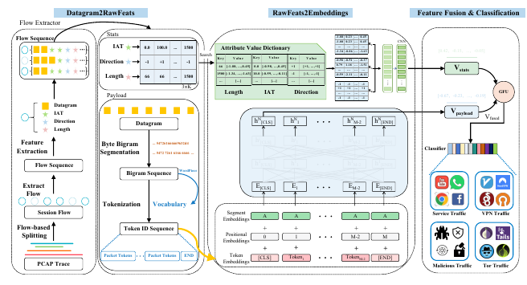
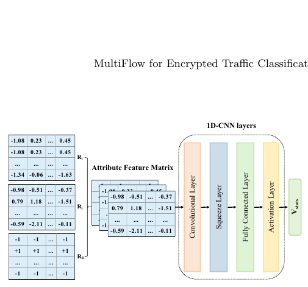
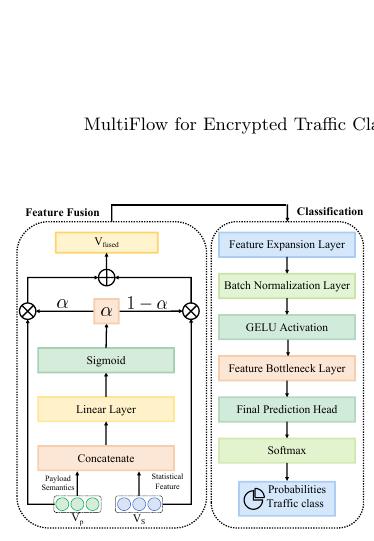
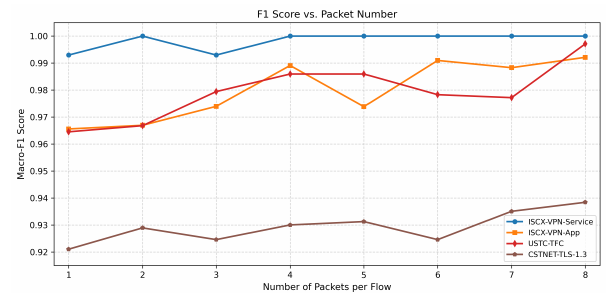

# MultiFlow

**MultiFlow: Robust Multimodal Representation Learning for Encrypted Network Traffic Classification**

MultiFlow combines payload semantic representations and packet-level statistical representations to classify encrypted network traffic. This repository contains the research implementation, PCAP preprocessing and feature extraction code, training and evaluation entry points, and a guide to the experiments reported in the paper.



**Start here:** [Installation](#requirements) · [Preprocessing](#data-preprocessing) · [Training](#training) · [Evaluation](#evaluation) · [Paper results](#reproduction)

The tables below reproduce values from the manuscript. The commands run the available code snapshot; they have not been verified by rerunning all paper experiments. Exact numerical reproduction also requires the original dataset selections, split files, vocabulary, embeddings and matching checkpoints. See [Release assets and implementation notes](#release-assets-and-implementation-notes).

## Overview

MultiFlow learns from two complementary views of a bidirectional flow:

- **Payload semantic features:** byte-bigram sequences are tokenized and encoded with a pretrained **ET-BERT** Transformer.
- **Statistical features:** packet **Length**, **Direction**, and **Inter-Arrival Time (IAT)** are mapped through attribute-value dictionaries into dense embeddings.
- **CNN statistical encoder:** a convolution over packet positions produces a flow-level statistical representation.
- **Gated multimodal fusion:** a learned gate combines both representations before an MLP predicts the traffic class.

The tasks cover TLS 1.3 application classification, VPN service/application classification, and benign/malicious traffic classification.

## Framework

**Figure 1: MultiFlow architecture.** The overview above shows flow extraction, the two representation branches, and fusion/classification.

**Figure 2: Attribute-value dictionary embedding and CNN-based encoding.**



**Figure 3: Gated fusion and classification pipeline.**



These are figures extracted from the supplied manuscript, not newly generated experimental results. See [figures/README.md](figures/README.md) for provenance.

### Repository layout

```text
MultiFlow/                         # local directory is named MutilFlow
├── README.md
├── requirements.txt
├── figures/                       # manuscript Figures 1-4
├── scripts/
│   ├── extract_features.py         # CLI adapter to the existing extractor
│   ├── dataset_stats.py            # split sizes and class counts
│   └── train.sh                    # one training run + best-checkpoint testing
├── code_5_28/
│   └── classfiy_New_wiseGatedFusion.py  # main model, ablations, training/evaluation
├── data_process/
│   ├── multiflow_batch_feature_extractor.py
│   ├── spliy_tra_tes_dev.py         # existing stratified 8:1:1 split script
│   └── ...                        # historical preprocessing variants
├── 20261014/
│   ├── CSTNET-TLS1.3/scripts/      # dataset-specific feature reconstruction
│   └── USTC-TFC2016/scripts/       # SplitCap + feature reconstruction
├── uer/                           # local UER/ET-BERT building blocks
├── models/bert/                   # model configuration JSONs
└── wordembedding/                 # external AVD dictionaries and embeddings
```

The pre-existing `src/` and `dataset/` directories are retained as legacy material. The commands below use `scripts/`, `code_5_28/` and `data_process/`; the legacy `src/models/train.py` is not the training entry point for this release. Existing research files are retained in place. The `uer/` package is required; do not replace it with an unrelated pip package. Historical comparison projects are not needed for the main commands below.

## Requirements

Use Linux with Python **3.10** as a practical starting point. The inspected server has Python 3.10.12 and PyTorch `2.3.0a0+40ec155e58.nv24.03`. The manuscript reports **PyTorch 1.8.0** and an **NVIDIA RTX 4090D**; these are the reported paper environment, not an installation lockfile.

Main dependencies: PyTorch, torchvision, NumPy, pandas, scikit-learn, Scapy, flowcontainer, matplotlib, Pillow, TensorBoard, tqdm and six. PCAP extraction additionally needs **TShark**; the existing USTC SplitCap driver uses **Mono** and an external **SplitCap.exe**.

```bash
python3.10 -m venv .venv
source .venv/bin/activate
python -m pip install --upgrade pip
# Install a torch/torchvision pair compatible with your CUDA driver first.
python -m pip install -r requirements.txt
# Ubuntu/Debian; needed for preprocessing, not for training prepared CSVs:
sudo apt-get install tshark mono-runtime
```

`requirements.txt` lists dependencies and broad compatibility ranges; it is not a fully tested, pinned environment. If an existing server environment raises `Descriptors cannot not be created directly` while importing TensorBoard, use `export PROTOCOL_BUFFERS_PYTHON_IMPLEMENTATION=python` before training (also when starting TensorBoard), or install compatible TensorBoard/protobuf versions in the virtual environment. The process-level environment option was used for the CPU smoke check on the inspected server. Mixed precision (`--fp16`) additionally uses NVIDIA Apex and is disabled in the examples. SentencePiece is optional and is not needed for the supplied vocabulary-based tokenizer.

Run commands from the repository root. Prepare these external files before training:

```text
models/encryptd_vocab.txt          # ET-BERT vocabulary
models/pre-trained_model.bin      # matching ET-BERT initialization checkpoint
wordembedding/len_dict.pkl
wordembedding/iat_dict.pkl
wordembedding/len_embedding.npy
wordembedding/iat_embedding.npy
```

The four AVD files must belong together; dictionary IDs index rows of the corresponding embedding matrix. Keep `PAD` and `UNK` entries. Only load trusted pickle/checkpoint files. Large binaries are excluded by `.gitignore` and need a separate download/release location.

## Dataset

### Table 1: Dataset Statistics

| Dataset | Task | Train | Dev | Test | Classes |
|---|---|---:|---:|---:|---:|
| CSTNET-TLS-1.3 | TLS 1.3 application classification | 37,098 | 4,637 | 4,637 | 120 |
| ISCX-VPN-Service | VPN service classification | 1,780 | 222 | 222 | 6 |
| ISCX-VPN-App | VPN application classification | 2,695 | 337 | 337 | 14 |
| USTC-TFC | Benign/malware traffic classification | 6,032 | 754 | 754 | 20 |

These are the paper's retained flow counts after preprocessing, with an 8:1:1 train/dev/test split. They are not raw PCAP counts. CSTNET labels correspond to 120 applications; the ISCX tasks use separate 6-class service and 14-class application labelings; USTC has 10 benign and 10 malware categories.

Obtain the datasets through their original providers and preserve their usage terms. Raw captures, private paths and generated datasets are not intended to be committed. A public download location for the authors' exact split files and ISCX label mappings still needs to be supplied.

## Data Preprocessing

The workflow is **raw captures → labeled session PCAPs → multimodal CSV → train/dev/test CSVs**. If prepared split CSVs are available, skip directly to Training.

### 1. Split captures into bidirectional sessions

For USTC, the existing driver maps 24 source PCAPs to 20 labels and calls `mono SplitCap.exe -r ... -s session -o ...`:

```bash
export MULTIFLOW_RAW_DIR=/path/to/USTC-TFC2016/raw/source
export MULTIFLOW_WORK_DIR="$PWD/data/USTC-work"
export MULTIFLOW_SPLITCAP=/path/to/SplitCap.exe
python3 20261014/USTC-TFC2016/scripts/01_splitcap_parallel.py
```

The raw layout is the `TASKS` list in that script, e.g. `Benign/BitTorrent.pcap`, `Benign/SMB/SMB/SMB-1.pcap` and `Malware/Cridex/Cridex.pcap`. Output goes to `$MULTIFLOW_WORK_DIR/splitcap/<label>/<source>/`; logs and session counts go to `$MULTIFLOW_WORK_DIR/logs/`. Existing nonempty session directories are skipped, so use a separate work directory for a fresh preparation run.

For any individual capture, including ISCX, the same tool can be called directly after assigning the appropriate class label:

```bash
mkdir -p data/ISCX-VPN-App/flows/CLASS_NAME/source_capture
mono "$MULTIFLOW_SPLITCAP" -r /path/to/source_capture.pcap \
  -s session -o data/ISCX-VPN-App/flows/CLASS_NAME/source_capture
```

Replace `CLASS_NAME` with the actual application or service class. Repeat for all captures. Service and application classification require separate label mappings; the precise paper mappings must be provided with the release. Do not treat service labels as application labels.

The CSTNET collection used by `20261014/CSTNET-TLS1.3/scripts/01_extract_features.py` is already split into flow PCAPs. Place them under `<pcap-root>/<class>/...`; no second session split is required for that collection.

Other retained scripts (`split_pcap.py`, `data_process/extract_flows.py`, `data_process/main.py`) are historical alternatives with dataset-specific settings. They are not required by this workflow; some contain interactive debugging or destructive cleanup operations, so use the explicit SplitCap path above for a new preparation run.

### 2. Extract payload and statistical features

The new CLI adapter calls the existing `process_dataset()` function in `data_process/multiflow_batch_feature_extractor.py`; it does not reimplement extraction:

```bash
python3 scripts/extract_features.py \
  --pcap-root "$MULTIFLOW_WORK_DIR/splitcap" \
  --output-root data --name USTC-TFC

python3 scripts/extract_features.py \
  --pcap-root /path/to/CSTNET/flow_pcaps \
  --output-root data --name CSTNET-TLS-1.3

python3 scripts/extract_features.py \
  --pcap-root /path/to/ISCX/service_labeled_flows \
  --output-root data --name ISCX-VPN-Service

python3 scripts/extract_features.py \
  --pcap-root /path/to/ISCX/application_labeled_flows \
  --output-root data --name ISCX-VPN-App
```

Each input root must contain one directory per class. By default the extractor samples up to 500 flow PCAPs per label with Python seed 40. It stores lengths, signed directions and IATs using flowcontainer; IATs are multiplied by 100 and rounded to one decimal place. Packet bytes are converted to bigram strings by the existing helper. The extractor retains up to 40 packets; the training reader limits statistical sequences to K and the payload token sequence to `64*K` tokens (512 at K=8), padding shorter inputs.

The existing extractor randomizes IP addresses/ports and currently returns full packet bytes through `bytes(packet).hex()` rather than stripping every header. Its bigram helper limits emitted segments to 64. These implementation details should not be read as a newly verified, literal 64-payload-byte preprocessing guarantee. They are preserved here to avoid changing the experiment code.

The output is `data/<name>/all_flows.csv`, with this exact column order:

```text
label,lengths,directions,iats,payloads
```

The four feature columns are JSON arrays inside quoted CSV fields. Length/IAT values are mapped through the AVD files; direction values use `1`, `-1` and a padding index. Every dev/test class must appear in training.

The generic extractor can emit multiple internal flow records for one input PCAP. The existing dataset-specific reconstruction scripts instead retain at most one record per selected PCAP and save detailed selection/failure manifests:

```bash
# USTC: uses the splitcap directory produced above.
MULTIFLOW_WORK_DIR="$PWD/data/USTC-work" \
  python3 20261014/USTC-TFC2016/scripts/02_extract_features.py

# CSTNET: expects exactly 120 classes and 46,372 candidate flow PCAPs.
MULTIFLOW_WORK_DIR="$PWD/data/CSTNET-work" \
MULTIFLOW_PCAP_ROOT=/path/to/CSTNET/flow_pcaps \
  python3 20261014/CSTNET-TLS1.3/scripts/01_extract_features.py
```

Their CSVs are saved under `<work-dir>/features/all_flows.csv`. These are alternative preparation routes, not additional stages to concatenate. Selection semantics differ from the generic batch extractor; use the authors' original selections/splits for exact paper comparisons. Existing `selected_pcaps.json` files may contain machine-specific paths and are reused on resume. Use a fresh work directory when moving to another machine.

### 3. Create train/dev/test splits

The existing script `data_process/spliy_tra_tes_dev.py` reads `all_flows.csv` from its working directory, performs stratified 80/10/10 splitting with seeds 41 and 42, and writes `splits/train.csv`, `splits/valid.csv` and `splits/test.csv`.

```bash
REPO_ROOT="$PWD"
cd data/USTC-TFC
python3 "$REPO_ROOT/data_process/spliy_tra_tes_dev.py"
cd "$REPO_ROOT"
python3 scripts/dataset_stats.py data/USTC-TFC/splits
```

Repeat for each dataset directory. If using a reconstruction CSV, run the split command from its `features/` directory instead. The split script overwrites existing split files; preserve the original paper splits separately. Actual sizes depend on retained rows and scikit-learn rounding and may differ from Table 1. This script creates a usable split; it does not reconstruct missing original split membership.

## Training

From the repository root, after preparing splits and external assets:

```bash
CUDA_VISIBLE_DEVICES=0 bash scripts/train.sh USTC-TFC data/USTC-TFC/splits
```

The wrapper invokes the existing classifier with explicit paths, K=8, 20 epochs, learning rate `2e-5`, batch size 16 and warmup 0.15. Use the same wrapper for each dataset:

```bash
CUDA_VISIBLE_DEVICES=0 bash scripts/train.sh CSTNET-TLS-1.3 data/CSTNET-TLS-1.3/splits
CUDA_VISIBLE_DEVICES=0 bash scripts/train.sh ISCX-VPN-Service data/ISCX-VPN-Service/splits
CUDA_VISIBLE_DEVICES=0 bash scripts/train.sh ISCX-VPN-App data/ISCX-VPN-App/splits
```

Additional arguments override the wrapper defaults, including asset paths:

```bash
CUDA_VISIBLE_DEVICES=0 bash scripts/train.sh USTC-custom data/USTC-TFC/splits \
  --pretrained_model_path /path/to/pre-trained_model.bin \
  --vocab_path /path/to/encryptd_vocab.txt \
  --length_emb_path /path/to/len_embedding.npy \
  --time_emb_path /path/to/iat_embedding.npy \
  --len_dict_path /path/to/len_dict.pkl --iat_dict_path /path/to/iat_dict.pkl
```

`models/bert/paper_config.json` requests Transformer dropout 0.5. The original base config is preserved. The loader applies JSON values after CLI parsing, so use the appropriate JSON to control dropout; `--dropout` alone does not override a JSON dropout value. The current gate/classifier still have fixed dropout 0.2. The default scheduler is cosine and the training seed is 7. No full training run was performed during repository preparation.

The direct entry point is `code_5_28/classfiy_New_wiseGatedFusion.py`; when invoking it without the wrapper, set `PYTHONPATH=.` and supply `--train_path`, `--dev_path`, `--test_path`, `--vocab_path`, `--pretrained_model_path`, `--output_model_path`, and the desired config. The script writes `label.json` beside the training CSV and therefore needs write access to that directory.

## Evaluation

Testing is integrated into training: after the final epoch, the script reloads the checkpoint with the highest validation **Macro-F1** and evaluates `--test_path`. It prints **Macro Precision**, **Macro Recall** and **Macro F1**, and saves per-class metrics and a confusion matrix.

For `bash scripts/train.sh USTC-TFC ...`, inspect:

```text
outputs/USTC-TFC/train.log                # training/dev/test console output
outputs/USTC-TFC/model.bin.best_temp      # best validation checkpoint
outputs/USTC-TFC/model.bin.metrics.tsv    # final test metrics and confusion matrix
runs/USTC-TFC/                           # TensorBoard events
```

The best model is saved with the `.best_temp` suffix; the unsuffixed `model.bin` is an output prefix and is not the final checkpoint file in this implementation. The TSV appends results; use a new run name for each independent run.

```bash
grep -E 'Macro Precision|Macro Recall|Macro F1' outputs/USTC-TFC/train.log
tensorboard --logdir runs
```

Metrics are computed per class and averaged equally across all training labels. The confusion matrix has **predicted labels in rows and true labels in columns**. There is no dedicated test-only CLI in the selected training entry point; do not pass an invented `--eval_only` flag or use the unrelated root `test.py` as the MultiFlow evaluator. A pretrained ET-BERT initializer is not a trained MultiFlow checkpoint.

## Reproduction

### Table 1: Dataset Statistics

Use the preprocessing/splitting workflow and run:

```bash
python3 scripts/dataset_stats.py data/CSTNET-TLS-1.3/splits
python3 scripts/dataset_stats.py data/ISCX-VPN-Service/splits
python3 scripts/dataset_stats.py data/ISCX-VPN-App/splits
python3 scripts/dataset_stats.py data/USTC-TFC/splits
```

The helper reports flows and classes for each split and detects dev/test labels absent from training. Compare with [Table 1](#table-1-dataset-statistics). Original split CSVs are required to recover the paper's exact counts and membership.

### Table 2: Main Results

**MultiFlow results reported in the paper (macro-averaged):**

| Dataset | Precision | Recall | Macro-F1 |
|---|---:|---:|---:|
| CSTNET-TLS-1.3 | 0.9491 | 0.9407 | 0.9384 |
| ISCX-VPN-Service | 1.0000 | 1.0000 | 1.0000 |
| ISCX-VPN-App | 0.9853 | 0.9672 | 0.9714 |
| USTC-TFC | 0.9917 | 0.9990 | 0.9949 |

Run the four Training commands with the matching data/assets, then collect the final test metrics from each TSV. The script selects the checkpoint using dev Macro-F1; the held-out test metrics are reported only after selection. These commands provide the current training/testing route, not a guarantee that this later code snapshot exactly reproduces the published numbers. Baseline rows from the paper are not claimed as reproduced by this repository.

### Table 3: Ablation Study

The existing `--ablation_mode` supports all three input settings:

| Setting | CLI mode | Active representation |
|---|---|---|
| Full model | `full` | Payload + statistics with gated fusion |
| w/o statistical features | `payload` | Payload branch only |
| w/o payload features | `stat` | Statistical branch only |

```bash
CUDA_VISIBLE_DEVICES=0 bash scripts/train.sh USTC-full data/USTC-TFC/splits --ablation_mode full
CUDA_VISIBLE_DEVICES=0 bash scripts/train.sh USTC-no-stat data/USTC-TFC/splits --ablation_mode payload
CUDA_VISIBLE_DEVICES=0 bash scripts/train.sh USTC-no-payload data/USTC-TFC/splits --ablation_mode stat
```

Repeat with the other datasets using identical splits and training settings. Even a single-modality run currently loads both sets of input assets; provide all files.

**Paper Table 3:**

| Dataset | Setting | Precision | Recall | Macro-F1 |
|---|---|---:|---:|---:|
| CSTNET-TLS-1.3 | Full model | 0.9491 | 0.9407 | 0.9384 |
| CSTNET-TLS-1.3 | w/o statistical features | 0.9012 | 0.8874 | 0.8889 |
| CSTNET-TLS-1.3 | w/o payload features | 0.8766 | 0.8466 | 0.8493 |
| ISCX-VPN-Service | Full model | 1.0000 | 1.0000 | 1.0000 |
| ISCX-VPN-Service | w/o statistical features | 0.9074 | 0.9167 | 0.9165 |
| ISCX-VPN-Service | w/o payload features | 0.7815 | 0.7983 | 0.8003 |
| ISCX-VPN-App | Full model | 0.9853 | 0.9672 | 0.9714 |
| ISCX-VPN-App | w/o statistical features | 0.9644 | 0.8902 | 0.8786 |
| ISCX-VPN-App | w/o payload features | 0.6044 | 0.6029 | 0.5797 |
| USTC-TFC | Full model | 0.9917 | 0.9990 | 0.9949 |
| USTC-TFC | w/o statistical features | 0.9798 | 0.9800 | 0.9799 |
| USTC-TFC | w/o payload features | 0.8698 | 0.8701 | 0.8653 |

### Figure 1

MultiFlow architecture: [figure1_architecture.png](figures/figure1_architecture.png). This is a conceptual paper diagram and requires no experimental rerun.

### Figure 2

Attribute-value dictionary embedding and CNN-based encoding: [figure2_statistical_encoder.png](figures/figure2_statistical_encoder.png). No experimental rerun is required.

### Figure 3

Gated fusion and classification pipeline: [figure3_gated_fusion.png](figures/figure3_gated_fusion.png). No experimental rerun is required.

### Figure 4: Impact of Packet Number

The paper evaluates **K = 1, 2, ..., 8 packets per flow**, measuring test Macro-F1 separately for each dataset.



The existing `train_gatedFusion_packetnumbers.sh` loops over these values, but retains server-specific paths and a shared output setup. For portable runs with separate outputs, use:

```bash
for k in 1 2 3 4 5 6 7 8; do
  CUDA_VISIBLE_DEVICES=0 bash scripts/train.sh "USTC-K${k}" data/USTC-TFC/splits \
    --packet_num "$k"
done
```

Repeat for the other three datasets. Each K changes the statistical convolution kernel and payload token budget, so train a separate model for each K. The reader concatenates packet strings and truncates the combined token sequence; this is the current implementation of the packet-count setting. The image above is the paper's Figure 4; none of these sweeps was rerun for this repository preparation.

## Experimental Settings

| Parameter | Paper setting |
|---|---|
| Packets per flow | 8 |
| Bytes per packet | 64 |
| Train / Dev / Test | 8:1:1 |
| Maximum epochs | 20 |
| Learning rate | 2e-5 |
| Batch size | 16 |
| Warmup ratio | 0.15 |
| Dropout | 0.5 |
| Checkpoint selection | Best validation Macro-F1 |
| Metrics | Macro Precision / Recall / F1 |

Implementation-specific settings: `--seed 7`, split seeds 41/42, extraction seed 40, cosine scheduler, 512-dimensional fusion representations. The JSON config requests Transformer dropout 0.5, while gate/classifier dropout remains 0.2 in the preserved model. The statistical encoder is implemented with `Conv2d(3, 1, kernel_size=(K, 1))`, followed by squeezing and projection.

## Release Assets and Implementation Notes

The current implementation uses an interaction-aware, dimension-wise gate over `[payload, statistics, payload*statistics, abs(payload-statistics)]`. The paper's Figure 3 illustrates a simpler concatenation/linear gate and a classifier with batch normalization; the current classifier uses linear/GELU/dropout layers without batch normalization. The current reader prepends `[CLS]` and pads/truncates, without explicitly appending the paper's `[END]` token. The code is preserved rather than silently changed to match the drawing.

Before claiming exact paper reproduction, provide the code/checkpoint version used for the manuscript and these assets:

- Original train/dev/test CSVs or sample selection manifests for all four datasets, including ISCX service/application label mappings.
- ET-BERT vocabulary and matching initialization checkpoint, with download location and provenance.
- The four matched AVD dictionary/embedding files, with their pretraining provenance; retraining the original CBOW corpus is not part of the supplied workflow.
- Best MultiFlow checkpoints and final test logs for the four main results and relevant ablations/packet-count runs.
- SplitCap executable/source distribution information. It is an external tool, not a Python dependency.
- Final paper URL, author/venue/year metadata, BibTeX, and a license chosen by the authors for the original code. Retain third-party notices for UER/ET-BERT components.

All four figures are included as manuscript crops. Original vector artwork is optional for improved display quality. The local server contains model/AVD files, but `.gitignore` intentionally keeps them out of a normal source commit; their existence locally does not give a fresh clone access to them.

### Preparing a source release

Use `MutilFlow/` as the public repository root. The existing parent Git repository also contains other projects; review the root before staging files. Include the documented `scripts/`, `code_5_28/`, `data_process/`, dataset-specific **scripts** and their historical helper modules, `uer/`, JSON configs, figures, and this README. Keep raw data, generated feature CSVs, checkpoints, TensorBoard logs and unrelated experiments out of the source release. Do not use `git add -f .` to bypass the exclusions.

## Citation

If you use MultiFlow, please cite the paper. Final bibliographic metadata will be added when confirmed:

```bibtex
% TODO: replace this placeholder with the final publisher/arXiv BibTeX.
% MultiFlow: Robust Multimodal Representation Learning for Encrypted Network Traffic Classification
```

## Acknowledgments

This implementation builds on ET-BERT and the bundled UER components. Please also acknowledge the original dataset providers and preserve upstream license notices when redistributing third-party code.
